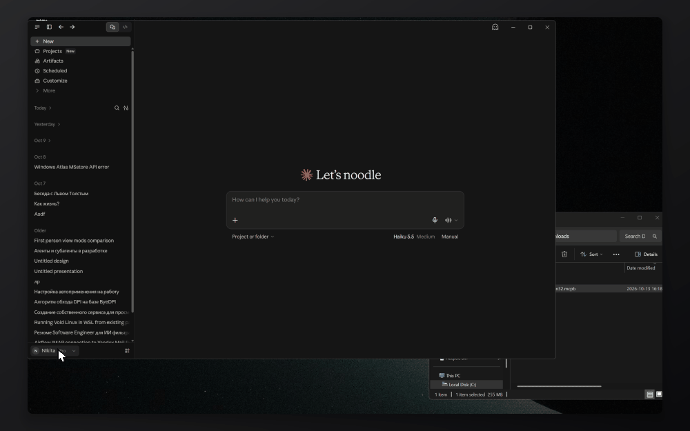
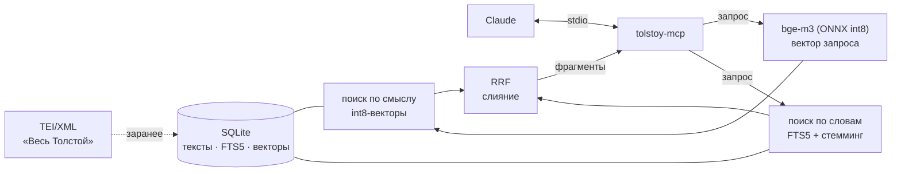

# tolstoy-mcp — память Толстого для Claude

Локальный MCP-сервер с поиском по 90-томному Полному собранию сочинений Л. Н. Толстого
(сочинения, дневники, записные книжки, письма), дневникам и воспоминаниям современников
(Гусев, Гольденвейзер, Маковицкий, С. А. Толстая) и примечаниям редакторов.

- `recall` — гибридный поиск фрагментов: по смыслу (bge-m3) и по словам (FTS5 со стеммингом), объединение через RRF;
- `read_document` — дочитать письмо, дневниковую запись или главу целиком или окно вокруг найденного фрагмента;
- промпт `tolstoy` — Claude говорит от лица Толстого, его орфографией, и ссылается на источники.

Всё работает локально, без API-ключей. При первом запуске скачивается около 800 МБ:
база текстов (≈200 МБ сжатая, 500 МБ на диске) и модель для запросов (≈590 МБ).

## Установка

### Claude Desktop

1. Скачайте `tolstoy-<версия>-<ОС>.mcpb` для своей системы со страницы [Releases](../../releases):
   `darwin` — macOS (Apple Silicon), `win32` — Windows (x64 и ARM), `linux` — Linux (x64 и ARM).
2. Откройте Claude Desktop → **Settings → Extensions**.
3. Перетащите скачанный `.mcpb` в окно и нажмите **Install**.



### Claude Code и другие MCP-клиенты

Из исходников, нужен Node.js ≥ 22.13:

```bash
git clone https://github.com/nikuma0/tolstoy-mcp && cd tolstoy-mcp
npm ci --ignore-scripts && npm run build
claude mcp add tolstoy -- node "$PWD/dist/index.js"
node dist/index.js download        # по желанию: скачать данные заранее, а не при первом вопросе
```

Пока данные скачиваются, инструменты отвечают, сколько осталось. Данные лежат в системном
каталоге данных приложения (`~/.local/share/tolstoy-mcp`, `~/Library/Application Support/tolstoy-mcp`,
`%LOCALAPPDATA%\tolstoy-mcp`); переопределить — переменной `TOLSTOY_DATA_DIR`.

```bash
node dist/index.js info                                       # что скачано и где
node dist/index.js search "что Толстой писал Фету о Шопенгауэре" --top 5
node dist/index.js search "непротивление злу насилием" --mine  # только тексты самого Толстого
```

## Как устроено

Корпус TEI/XML заранее разобран на фрагменты, векторизован моделью bge-m3 и сложен в одну базу SQLite.
На запрос сервер ищет параллельно по смыслу и по словам и сливает результаты:



- **SQLite** через встроенный `node:sqlite`: без нативных аддонов, поэтому работает и во встроенном
  Node Claude Desktop (Electron), где аддоны под чужой ABI не грузятся.
- **Векторы** — int8 в обычной таблице (113 МБ вместо 450), поиск полным перебором в JS за ~125 мс.
  sqlite-vec пробовали: без ANN-индекса он не быстрее, а нативную сборку тянет. Ранжирование int8 почти
  не отличается от float32 (топ-10 совпадает на 9–10 из 10).
- **Полнотекстовый поиск** — FTS5 по основам слов: в SQLite нет русского стеммера, поэтому и текст, и запрос
  заранее прогоняются через Snowball (`snowball-stemmers`).
- **Модель запросов** — [Xenova/bge-m3](https://huggingface.co/Xenova/bge-m3) (ONNX int8) через `onnxruntime-node`
  и `@huggingface/tokenizers`; это та же BAAI/bge-m3, которой векторизован корпус (косинус с Python-версией 0,98).

## Разработка

```bash
npm ci --ignore-scripts      # postinstall onnxruntime-node докачивает CUDA; нам нужен только CPU
npm test                     # vitest: юнит-тесты и MCP-сервер на мини-базе из test/fixture.ts
npm run lint && npm run typecheck
npm run build                # tsup → dist/index.js
npm run dev -- search "Ясная Поляна"
```

Сквозной тест на настоящих данных (собранный `dist`, stdio): положить базу и модель в `.data/`
(`TOLSTOY_DATA_DIR=.data node dist/index.js download`) и запустить `TOLSTOY_E2E_DATA_DIR=.data npm test`.

### Новая версия данных

1. В репозитории TEI: `cd importer && uv run tei-importer export` (дамп в `importer/export/`).
2. Здесь: `npm run build:db -- <путь к export> --gzip` — соберёт `build/tolstoy-v1.db(.gz)` и впишет размер и sha256
   в `data/assets.json`.
3. Выложить: `gh release create data-v1 build/tolstoy-v1.db.gz` (или `gh release upload data-v1 … --clobber`),
   закоммитить `data/assets.json`. Если меняется схема, поднять `DB_FORMAT` в `src/schema.ts`:
   имя файла станет `tolstoy-v2.db`, и старые установки не подхватят несовместимую базу.

### Релиз

`npm version patch && git push --follow-tags`. Workflow `release.yml` собирает `.mcpb` под каждую ОС,
проверяет каждый на своей платформе (`scripts/smoke.mjs`: нативный onnxruntime грузится, сервер отвечает
на `initialize` и `tools/list`) и выкладывает их в GitHub Release. В npm пакет не публикуется.

## Лицензия

Код — MIT. Тексты — корпус [«Весь Толстой в TEI/XML»](https://github.com/tolstoydigital/TEI)
проекта Tolstoy Digital, CC BY-SA. Модель BAAI/bge-m3 — MIT.
